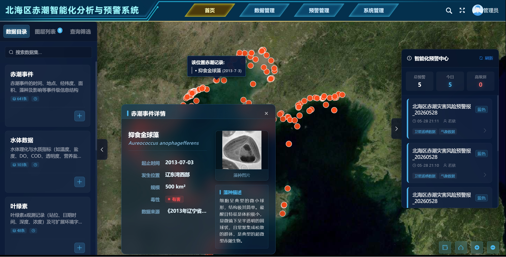

# 北海赤潮智能化预警模块开发平台

**核心开发成员 · 2025.11—2026.03**

## 项目介绍
北海赤潮智能化预警模块开发平台是山东科技大学与自然资源部北海生态中心（青岛）协作开发的一个服务于北海赤潮监测与预警的数据管理和空间可视化平台
主要面向海洋赤潮监测预警业务，项目采用 RuoYi 框架（Vue 2、Java Spring Boot、PostgreSQL），并结合 Mapbox GL JS 与 Turf.js 实现 NetCDF 气象数据空间可视化，展示动态风场与气温热力图。
| |
|:---:|
| 首页 |
## 个人主要工作

- 实现 NetCDF 气象数据的空间可视化与动态风场展示。
- 独立开发低代码“动态表”模块，支持通过 Web UI 创建和管理数据库表。
- 自动生成菜单路由、增删改查页面及数据导入功能。

## 项目图片

## 技术栈总览

### 一、后端技术

| 技术 | 版本 | 说明 |
|------|------|------|
| **Java** | OpenJDK 1.8.0 | 运行环境 |
| **Spring Boot** | 2.5.15 | 核心应用框架 |
| **Spring Framework** | 5.3.39 | IoC / AOP 基础框架 |
| **Spring Security** | 5.7.14 | 认证与权限管理（RBAC） |
| **Spring Data Redis** | — | 缓存与会话管理 |
| **MyBatis** | — | ORM 持久层框架（通过 RuoYi 集成） |
| **PageHelper** | 1.4.7 | MyBatis 分页插件 |
| **Druid** | 1.2.23 | 阿里巴巴数据库连接池 |
| **JWT (jjwt)** | 0.9.1 | Token 生成与验证 |
| **Fastjson2** | 2.0.58 | JSON 序列化/反序列化 |
| **Swagger3 (Springfox)** | 3.0.0 | RESTful API 文档 |
| **Apache POI** | 5.2.3 | Excel 导入导出 |
| **poi-tl** | 1.12.1 | Word 模板导出 |
| **Quartz** | — | 定时任务调度 |
| **Velocity** | 2.3 | 代码生成模板引擎 |
| **Lombok** | 1.18.30 | 简化 Java 样板代码 |
| **Kaptcha** | 2.3.3 | 验证码生成 |
| **Logback** | 1.2.13 | 日志框架 |
| **Tomcat (内嵌)** | 9.0.108 | Web 容器 |
| **SQLite JDBC** | 3.36.0.3 | MBTiles 瓦片数据读取 |
| **OSHI** | 6.8.3 | 服务器系统信息采集（CPU、内存等） |

### 二、前端技术

| 技术 | 版本 | 说明 |
|------|------|------|
| **Vue.js** | 2.6.12 | 渐进式 JavaScript 框架 |
| **Vue Router** | 3.4.9 | 前端路由管理 |
| **Vuex** | 3.6.0 | 全局状态管理 |
| **Vue Composition API** | 1.7.2 | Vue 2 组合式 API 支持 |
| **Element UI** | 2.15.14 | 桌面端 UI 组件库 |
| **Axios** | 0.28.1 | HTTP 请求库 |
| **ECharts** | 5.4.0 | 数据可视化图表 |
| **Mapbox GL JS** | ^3.17.0 | WebGL 地图渲染引擎 |
| **MapLibre GL** | ^4.3.2 | 开源地图渲染引擎 |
| **Mapbox GL Draw** | ^1.5.1 | 地图绘图工具 |
| **Turf.js** | ^7.3.1 | 地理空间分析计算库 |
| **D3 (d3-contour / d3-array)** | — | 等值线与数据数组处理 |
| **XLSX (SheetJS)** | ^0.18.5 | 前端 Excel 解析 |
| **Quill** | 2.0.2 | 富文本编辑器 |
| **Splitpanes** | 2.4.1 | 面板分割布局 |
| **Vue CLI** | 4.4.6 | 项目脚手架与构建工具 |
| **Sass / Less** | 1.32.13 / ^4.5.1 | CSS 预处理器 |
| **Webpack (内置)** | — | 模块打包工具 |
| **Gzip 压缩** | compression-webpack-plugin 6.1.2 | 生产环境静态资源压缩 |
| **worker-loader** | 3.0.8 | Web Worker 支持 |

### 三、数据库

| 技术 | 说明 |
|------|------|
| **PostgreSQL** | 主数据库（关系型），存储业务数据、用户权限、海洋监测数据等 |
| **Redis** | 缓存数据库，用于 Token 存储、会话管理、数据缓存 |
| **SQLite (MBTiles)** | 轻量级嵌入式数据库，用于地图瓦片数据存储和读取 |

### 四、AI与算法模块

| 技术 | 说明 |
|------|------|
| **Python 3** | AI 后处理脚本运行环境 |
| **LightGBM / Random Forest** | 赤潮风险预测机器学习模型 |
| **空间后处理算法** | 受灾面积计算、风险重心方位角分析 |

### 五、GIS地图框架

| 技术 | 说明 |
|------|------|
| **Mapbox GL JS** | WebGL 高性能地图渲染（底图、矢量图层） |
| **MapLibre GL** | 开源替代方案，兼容 Mapbox 样式规范 |
| **Turf.js** | 空间分析（缓冲区、面积计算、空间查询等） |
| **D3-contour** | 叶绿素 a / 温度等值线可视化 |
| **MBTiles** | 离线瓦片地图存储格式 |