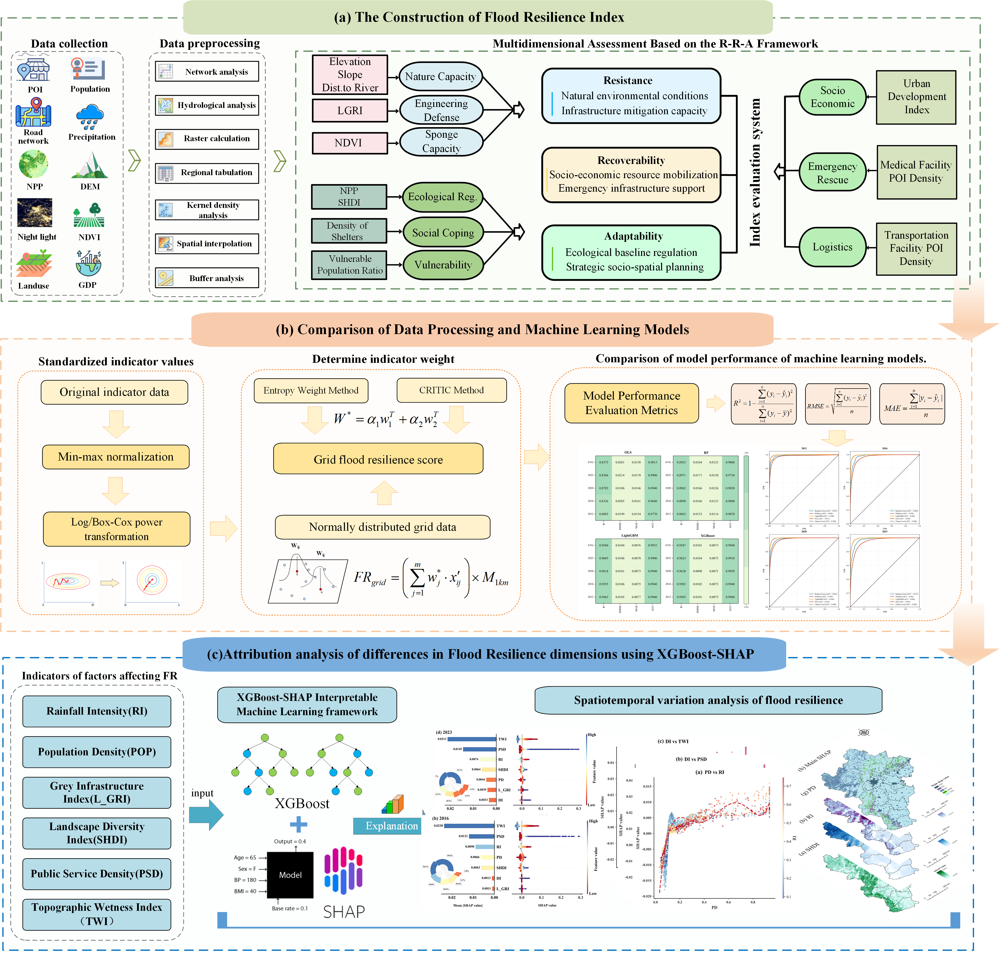
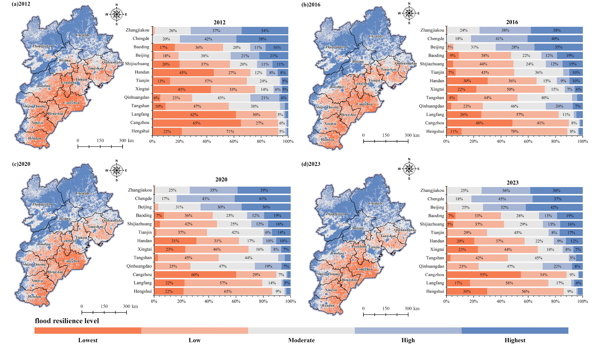

# Spatiotemporal assessment and structural attribution of urban flood resilience using interpretable machine learning: evidence from the Beijing–Tianjin–Hebei Urban Agglomeration

**Yu, Y., Bi, J., Bing, X., Song, S., Tan, J., & Mou, N. (2026).** *Geomatics, Natural Hazards and Risk*, 17(1), 2707774. 2026 年 7 月 27 日在线发表。

[DOI: 10.1080/19475705.2026.2707774](https://doi.org/10.1080/19475705.2026.2707774)

## 核心研究问题

在极端降雨和快速城市化的背景下，研究以北京、天津和河北 11 个地级市为对象，评估城市系统抵御洪涝冲击、灾后恢复和长期适应的能力。论文聚焦三个问题：2012—2023 年间京津冀洪涝韧性如何演变？不同地区的韧性差异主要与哪些因素相关？这些因素的贡献是否随地区和取值范围而变化？
| |
|:---:|
| 技术路线图 |

## 方法论

1. **构建网格化洪涝韧性指数。** 选取 2012、2016、2020 和 2023 年四个时点，将降水、地形、土地覆盖、人口、经济活动和公共服务设施等数据汇总至 3 km × 3 km 网格。按抵御力、恢复力和适应力（R–R–A）组织指标，用最小二乘法组合熵权法与 CRITIC 法的权重，再计算综合洪涝韧性指数（FR）。三个维度的权重分别为 0.367、0.364 和 0.269。
2. **比较模型并解释指标贡献。** 比较普通最小二乘回归（OLS）、随机森林、LightGBM 和 XGBoost。对表现最好的 XGBoost 使用 SHAP，分析地形湿度、降雨强度、人口密度、开发水平、公共服务设施密度、灰色基础设施和景观多样性对模型输出的贡献及其非线性变化。采用随机十折与按城市分组的空间交叉验证，并通过仅保留地形湿度和降雨强度的模型，检验部分解释变量与指数构建指标重叠的影响。
3. **对照独立洪涝观测。** 将 MODIS MCDWD 洪涝淹没范围汇总到同尺度网格，通过 Spearman 秩相关和韧性分组比较，检验综合指数与卫星观测洪涝暴露的空间关系。

## 结果与讨论

- **综合韧性整体提升，空间差异持续存在。** 2016 年后提升更明显。综合高值集中在北部及西北生态山区和核心城市，中南部平原长期偏低。抵御力受地形约束，变化较小。恢复力的改善主要集中在北京、天津、石家庄等核心城市，适应力总体稳定。
- **地形湿度贡献最大，公共服务设施的重要性上升。** 在模型对比中，XGBoost 的平均 R² 为 0.9587，RMSE 为 0.0101，MAE 为 0.0073。地形湿度指数（TWI）在四个时点均位居 SHAP 重要性首位，约占总重要性的 35%。到 2023 年，公共服务设施密度的重要性超过降雨强度，在核心城市表现尤为突出。
- **归因呈现非线性和空间差异。** 灰色基础设施指数的模型贡献呈倒 U 形，标准化值约 0.85 后回落。降雨强度的贡献在标准化值约 0.2 后由正转负。这些拐点描述模型对综合指数的响应，不能直接作为水文阈值。燕山—太行山及东南沿海低地更多受自然因素影响，北京、天津和石家庄周边则更受公共服务和开发水平影响。
- **高韧性与高暴露可以共存。** 四个时点中，韧性指数与卫星观测洪涝暴露均呈显著正相关（Spearman ρ 为 0.3687–0.4340，均 p < 0.001），高韧性组的洪涝暴露中位数也更高。韧性指数衡量的是应对能力，卫星记录的是淹没暴露。SHAP 结果用于解释构建的指数，无法据此推断实际灾损的因果效应。

| |
|:---:|
| 京津冀城市群洪涝韧性2012-2023时空演变 |
## 分区治理启示

西北生态区应保持景观完整性和自然蓄滞能力。低洼平原应预留行洪与蓄滞空间，恢复湿地。高密度城区应完善医疗、交通和应急服务网络，并协调排水改造与绿色基础设施建设。区域筛查可优先关注高暴露、低韧性的网格。

[研究数据与 SHAP 结果（Mendeley Data）](https://doi.org/10.17632/dwdjxvkmhc.1)

## 论文原文 PDF

<a href="pdfs/flood-paper.pdf" target="_blank" rel="noopener">在新窗口打开 PDF</a> · <a href="pdfs/flood-paper.pdf" download>下载 PDF</a>

<iframe src="pdfs/flood-paper.pdf" title="京津冀城市群洪涝韧性论文原文 PDF" width="100%" height="800" loading="lazy" style="display:block; border:1px solid #d9e5f6; border-radius:12px;"></iframe>
