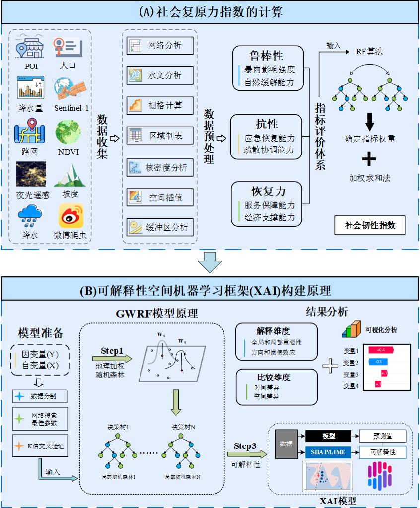
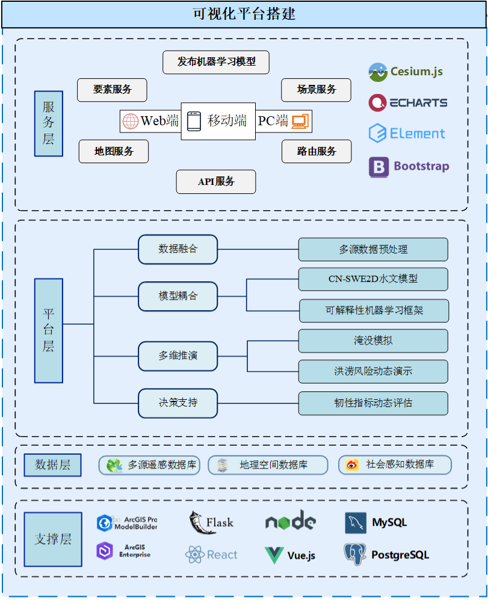
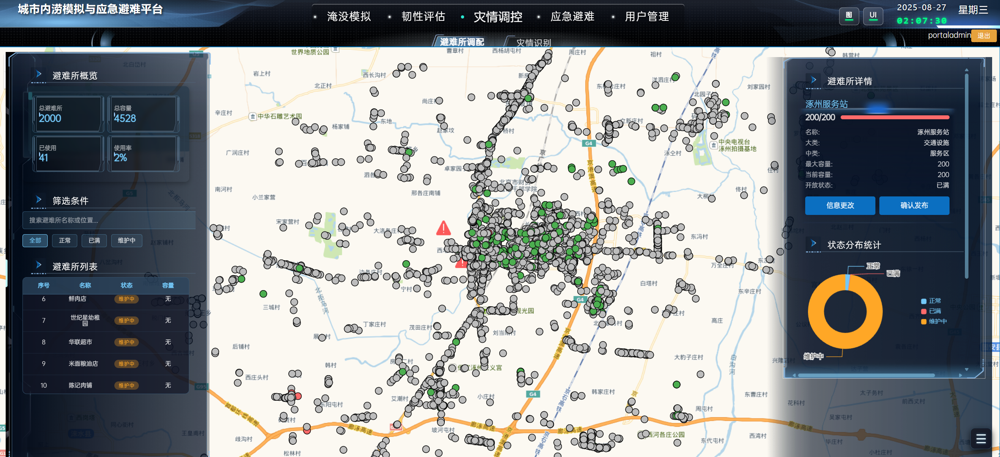
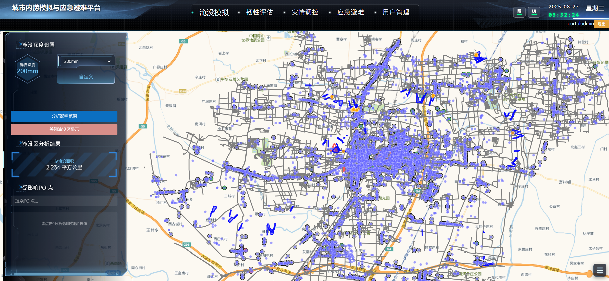

# 雨洪慧眼——IML 与水文模型协同驱动的城市雨洪韧性评估与决策平台

**项目主持 · 国家级大学生创新创业训练计划优秀结项 · 2025.05—2026.05**  
项目编号：202510424118

## 项目简介
- 面对极端降雨频发、城市内涝研判滞后、机器学习“黑箱化”与业务平台割裂等痛点，团队面向京津冀城市群构建“评估-模拟-决策”一体化平台，以多源数据和智能模型支撑城市防灾减灾由被动防御向主动适应转变。
- 融合遥感、夜光、POI、人口经济格网和网络舆情等数据，协同GWRF-SHAP可解释性机器学习与CN-SWE2D水文模型，打造可解释、可推演、可交互的城市雨洪韧性决策平台。
### 创新点
- **（1）多模态动态评估：**
  构建改进的3Rs“抵御力-恢复力-适应性”指标体系，刻画2012-2023年洪涝韧性的长时序演变与多尺度空间差异。
- **（2）可解释智能诊断：**
  以GWRF捕捉空间非平稳性，以SHAP量化降雨强度、灰色基础设施和城市发展等因子的贡献方向，识别“高风险-低建设”区域。
- **（3）物理模型与平台耦合：**
  将高精度水文模拟、三维时空表达与WebGIS微服务架构协同，实现多情景淹没模拟、脆弱性评估、灾情调控和避难导航。

| 技术路线图 I | 技术路线图 II |
|:---:|:---:|
|  |  |
## 项目研发与关键技术
### 项目进度

| 阶段 | 时间 | 关键工作 |
|:---:|:---:|---|
| **数据准备** | 2025.05—2025.07 | 汇集并清洗京津冀2012—2023年降水、DEM、土地利用、夜光、POI及经济人口格网等数据，统一投影、分辨率与空间尺度。 |
| **模型攻坚** | 2025.07—2025.12 | 构建GWRF-SHAP可解释空间机器学习框架，完成洪涝韧性驱动机制与空间异质性分析，并推进CN-SWE2D模型耦合。 |
| **平台集成** | 2026.01—2026.04 | 完成WebGIS平台、权限管理与核心业务模块集成，开展并发测试、性能调优和成果验收。 |

### 项目难点
- **难点一：多源数据空间错位**
针对遥感、POI、文本和统计格网在坐标系、分辨率与数据结构上的差异，团队建立统一投影、重采样、空间插值与文本地理编码流程，提升数据融合的一致性。
- **难点二：模型计算与解释压力**
将GWRF-SHAP任务后端化，结合GPU并行、空间掩膜和冗余样本清理，提高大尺度模型训练效率，并通过可视化复核纠正解释偏差。
- **难点三：三维渲染性能瓶颈**
采用WMTS切片、分级细节（LOD）与3D Tiles渐进加载，让大体量水文模拟结果按需加载，保障浏览器端稳定、流畅交互。

### 平台功能

- 平台已集成以下六类核心功能：1. **多情景淹没模拟**；2. **城市洪涝韧性评估** 3. **避难所调控**；4. **灾情识别** 5. **公众灾情上报**；6. **避难导航**
- 同时，平台面向**管理员与公众**设置分级访问权限，实现不同用户角色下的业务管理与功能协同。

|  |
|:---:|

| |
|:---:|
| 避难所调控&淹没模拟 |
## 项目产出
- **学术成果：** 围绕城市洪涝韧性时空演变与非线性驱动机制，形成SCI二区论文1篇；在项目持续引导下，团队成员以第一作者发表SCI三区论文1篇。
- **工程研发：** 完成“城市内涝模拟与应急避难平台”研发，软件著作权1项已受理；形成涵盖数据处理、模型推理、地图服务与前端交互的完整技术链路。
- **赛事荣誉：** 依托项目及拓展应用，团队累计取得国家级竞赛成果8项、省部级成果6项，其中项目组成员作为第一完成人获得学校认定B类竞赛成果7项；项目获国家级大学生创新创业训练计划优秀结项。

## 项目附件

[在新窗口打开或下载项目材料 PDF](pdfs/yhhy_lixiang.pdf)

<iframe src="pdfs/yhhy_lixiang.pdf#toolbar=1&navpanes=0" title="雨洪慧眼项目材料 PDF" width="100%" height="800" style="border:1px solid #d9e5f6;border-radius:12px;background:#fff"></iframe>
